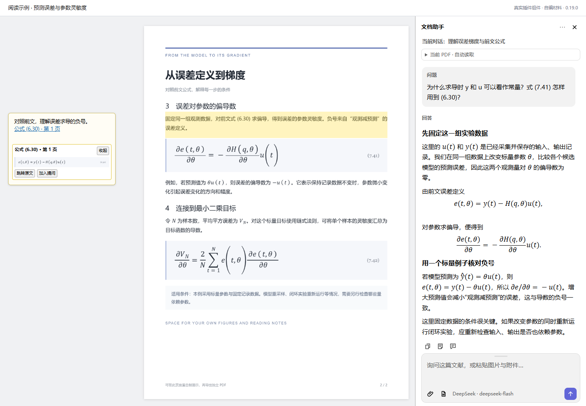
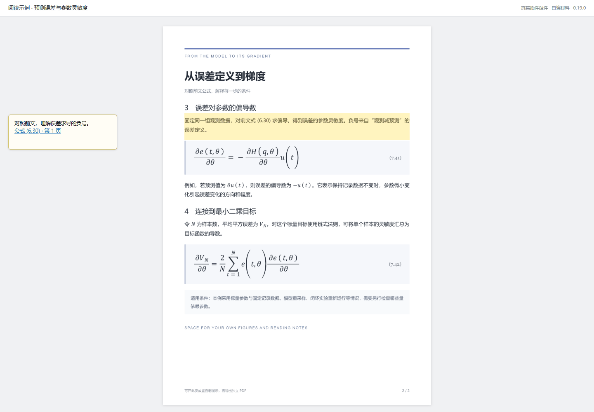
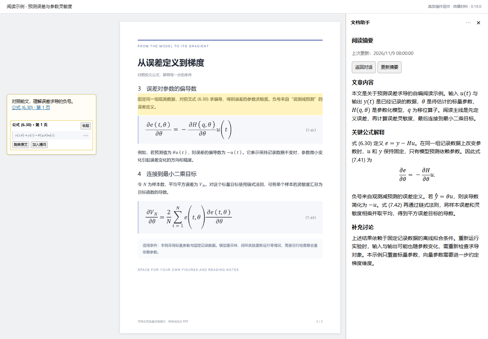
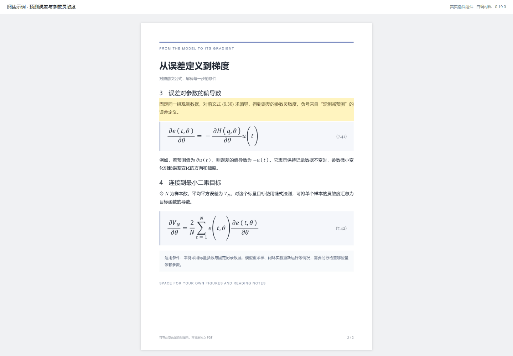

# Zotero Margin Assistant

边读论文，边对照公式、追问推导，把弄懂的内容留下来。

[](https://github.com/Yuxuan-Liang-git/zotero-margin-assistant/releases/latest) [](https://www.zotero.org/)

面向 Zotero 10.0.x 的 PDF 文献阅读插件，将页边批注、公式引用、AI 对话、阅读摘要和关联的 Notion 笔记放在同一个阅读界面中。

[下载最新版本](https://github.com/Yuxuan-Liang-git/zotero-margin-assistant/releases/latest) · [使用指南](docs/user-guide.md) · [更新日志](CHANGELOG.md) · [反馈问题](https://github.com/Yuxuan-Liang-git/zotero-margin-assistant/issues)



从一处看不懂的推导出发：左边对照前文公式，中间继续阅读，右边追问原因。截图和动图采用 0.19.0 的实际插件组件、自编 PDF 与示例对话，在后台无头浏览器中录制。查看 [素材说明与复现方式](docs/media/README.md)。

## 为什么做这个项目

阅读包含大量公式和交叉引用的论文时，理解一段推导往往需要回看前面的定义、查看另一页的公式，再将讨论结果整理到笔记中。问题、原文和笔记分散在多个窗口中，重新打开论文后也容易重复追问已经讨论过的内容。

本项目希望把这些阅读动作连接起来：在 PDF 中选择文字或框选公式后直接提问，在当前页查看引用的前文，将讨论中形成的理解整理为可独立阅读的笔记，并在需要时检索个人文献库中的相关材料。已有 Notion 笔记也可以放在旁边，与原文和文档助手同时阅读。

## 主要功能

| 阅读场景 | 提供的功能 |
| --- | --- |
| 讨论当前论文 | 自动加入当前 PDF 可提供的材料，支持文字和区域提问、附件、多段会话，以及 Markdown 和 LaTeX 回答。可使用 DeepSeek API 或 ChatGPT 账户授权接入。 |
| 追溯公式和前文 | 手动标记公式、段落、图表的编号，在页边批注中引用；悬停链接查看来源截图或文字，并可跳转原文。 |
| 在页面上做批注 | 页边批注和 PDF“新增文字”支持 LaTeX 显示；图片可粘贴、拖入、查看原图，也可放到 PDF 页面上拖动、缩放和锁定。 |
| 保存阅读结论 | 每份 PDF 保存独立会话列表，并维护单独的阅读摘要笔记；摘要按内容更新，保护手动改写的正文。 |
| 联系其他论文 | 在本地索引个人文献库的书目信息、PDF 文字、笔记和文字标注，可配置独立 Embedding 服务进行语义检索，并保留来源入口。 |
| 配合 Notion 阅读 | 复用文献下已有的 Notion 链接打开对应笔记；Notion 和文档助手可同时显示，独立调整宽度和左右位置。 |

页面图片可通过“导出带图片的 PDF”写入一份新文件，供其他 PDF 阅读器查看。原 PDF 继续用于调整图片的位置和尺寸。

## 从一处公式开始

读到式 (7.41)，需要回看前面的式 (6.30) 时，可以先为前文标记编号，再把来源链接插入当前批注。悬停即可对照原式，点“加入提问”还能把这处材料带到助手中继续讨论。



[查看静态预览](docs/media/formula-reference.png) · [如何标记和引用前文](docs/user-guide.md#标记和引用前文)

### 把弄懂的内容留下来

讨论结束后，“阅读摘要”把已经澄清的内容整理到文章内容、关键公式解释和补充讨论中。重新打开论文时，可以先看笔记，再接着上次的理解往下读。



### 把自己的图放到 PDF 上

有时画一张关系图，比再写一段话更容易理解。把图片放到 PDF 页面后，可以拖到合适位置、调整大小并锁定；需要分享时，再导出一份带图片的 PDF。



[查看静态预览](docs/media/page-images.png) · [图片与导出操作](docs/user-guide.md#在-pdf-页面放置和导出图片)

## 安装

目前支持 Zotero 桌面版 10.0.x，主要在 Windows 环境验证。当前版本为 0.20.0；其他 Zotero 大版本尚未列入兼容范围。

从 [Releases](https://github.com/Yuxuan-Liang-git/zotero-margin-assistant/releases/latest) 的 Assets 下载 `.xpi` 安装包。在 Zotero 中打开“工具 → 插件”，通过右上角齿轮菜单的“从文件安装插件”选择该文件。已有版本可直接覆盖安装，随后完全退出并重新打开 Zotero。

打开一份 PDF 后，可在阅读器工具栏打开文档助手或 Notion 栏。AI 服务、字体大小、自定义提示词和文献库记忆等设置集中在“设置 → 页边批注”中。当前升级方式为从 Releases 手动安装新版。

## 快速开始

### 配置 AI 服务

在“设置 → 页边批注 → 文档助手”中选择服务。使用 DeepSeek 时填写自己的 API Key 并应用设置；使用 ChatGPT 时通过账户授权入口完成登录。ChatGPT 的可用模型、思考强度、速度档位和额度，以账户实际开放的能力和服务返回结果为准。

打开 PDF 和文档助手后即可提问。插件会根据文档、服务能力和请求预算，加入整份 PDF、相关文字片段或少量页面图像；界面会显示本轮实际提供的范围。Enter 发送，Shift+Enter 换行，输入法选字期间的 Enter 保留给输入法处理。

如果问题涉及某个图片公式或局部推导，可先选中文字，或框选对应区域，再使用右键菜单的批注提问入口。也可向输入区粘贴或拖入 PDF、图片附件。

### 配置全库语义检索

0.20.0 可使用独立的 Embedding 服务，检索个人文献库中与问题含义相关的文字片段。在“设置 → 页边批注 → 云端语义检索”填写自己的 Embedding API Key，默认完整端点为 `https://api.siliconflow.cn/v1/embeddings`，模型为 `BAAI/bge-m3`，也可填写兼容的 HTTPS 端点与模型。此密钥与 DeepSeek 对话 Key、ChatGPT 登录分别管理，按完整端点经系统密钥库加密保存。

保存配置、测试连接并启用后，先点击“试建 20 篇”核对覆盖和服务费用，再按需要建立全库索引。安装、保存设置、连接测试和打开 PDF 都不会触发首次全库上传。可暂停后台任务；打开的 PDF 获得处理优先级，已经有效的索引仍可检索。默认每输入最多 8000 UTF-8 字节、每批最多 8 条、后台每分钟最多 20 次请求，大文献库首次建立可能需要数小时，实际时间和费用由文字量、服务限速与重试决定。

“自动关联个人文献库”总开关关闭后，不再进行后台向量任务或本轮跨文献检索，也不会返回词面回退来源；Embedding 配置和加密密钥保留。后台暂停只暂停建库，已就绪向量仍可用于提问。已授权的全库索引暂停期间有新资料时，点击继续会扫描更新并复用成功向量。

提问先按原始问题判断是否需要跨文献检索，再将当前标题与近期主题一起送入有字节上限的语义查询。相同完整查询、当前 PDF 文件指纹和模型空间的查询向量最多缓存 60 秒、32 条；配置、文件或问题上下文改变后不会错误复用，失败和取消不写入缓存。缓存只在本次运行内保留向量。

云端负责把已提交的文献文字、合格正式摘要和完整问答转换为向量，本地负责保存、检索、筛选和来源核对；提问时再把选中的片段加入对话服务请求。Notion 页面、草稿、未完成回答和历史检索缓存不会作为 Embedding 材料。断网或语义检索超过 8 秒时使用有效的本地检索结果，当前 PDF 材料继续保留。详情与验证边界见 [0.20.0 说明](docs/2026-11-10-cloud-rag-release.md)。

### 在当前页查看前文公式

例如，阅读公式 (7.41) 时需要回看公式 (6.30)，可以先在前文框选公式及其说明，通过右键“标记为引用来源”记录编号 `6.30`；文字也可直接选择后标记。

回到当前页，在页边批注中选择“插入引用”并输入编号。引用链接可预览前文的公式截图、图片或文字，帮助对照两处内容；需要检查上下文时，再通过来源入口跳转原文。编号相同的多个来源会分别列出供选择。

### 将讨论整理为阅读笔记

每份 PDF 有自己的会话列表。可为不同问题建立会话，关闭侧栏后再次打开，已有问答和草稿仍保留在本地。“阅读摘要”将本 PDF 各段会话中已经澄清的内容整理为独立笔记，按文章内容、关键公式解释和补充讨论组织。

启用自动摘要后，完整回答结束并空闲一段时间时会考虑更新笔记；没有新增理解时可保持原文。自动整理会使用当前 AI 服务的额度，可在设置中关闭，也可手动更新。已有人工改写会受到保护，新整理的内容可作为候选版本保存。

### 并排打开 Notion 笔记

如果文献已经通过 [Notero](https://github.com/dvanoni/notero) 等方式保存了关联的 Notion 链接，点击阅读器的 Notion 图标即可打开对应页面。首次使用需要在该网页中登录 Notion；存在多个链接时可在栏目菜单中切换。

Notion 栏和文档助手可以同时显示。拖动标题栏可调整左右位置，拖动内侧边缘可调整宽度。文献信息和笔记向 Notion 的同步由 Notero 等原有工具负责，本插件使用关联链接提供阅读入口。

## 数据保存与服务边界

| 数据 | 保存位置 |
| --- | --- |
| 会话、草稿、引用关系、阅读摘要和页面图片位置 | PDF 同目录的 `margin-comments-assistant-<libraryID>-<attachmentKey>.json`。 |
| 插入的图片 | PDF 专用的 Zotero 图片笔记及其嵌入附件，同时在 PDF 同目录的 `margin-comments-images/` 保存副本。 |
| 独立阅读摘要 | 关联的 Zotero 笔记，并在本地会话数据中保留正文和更新状态。 |
| 文献检索索引 | Zotero 数据目录下的 `margin-comments-assistant/research-memory/`，个人文献库正文索引为 `papers-v1.sqlite`，云端派生向量为独立的 `vectors-v1.sqlite`。 |
| AI 授权凭据 | 通过 Zotero `OSKeyStore` 加密后保存在本机设置中。 |

发送问题时，所选 PDF、选区、附件和被检索到的相关片段会按本轮输入范围提交给对应 AI 服务。启用自动摘要后，也会向所选服务提交需要整理的讨论文字。Notion 网页内容不会自动加入 AI 材料。

PDF 旁的 JSON、图片副本和研究索引需要自行备份，不承诺通过 Zotero Sync 同步；原生 Zotero 笔记和嵌入图片则由 Zotero 的同步机制管理。插件中的本地会话与 ChatGPT 网页聊天分别保存，可通过对话导入、导出进行衔接。

云端向量库位于 Zotero 数据目录下的 `margin-comments-assistant/research-memory/vectors-v1.sqlite`。“清除派生向量索引”只清除当前向量空间的派生数据，保留 PDF、原始问答、正式摘要与本地正文索引；更换端点、模型或维度需要对应的向量空间。

## 当前限制

扫描件和图片公式需要相应的页面图像作为输入。插件尚未提供整书 OCR 或自动公式编号索引；前文引用采用手动标记。文档较大、服务不支持某类输入或请求预算不足时，实际提供给模型的内容可能是片段，应结合界面中的输入范围判断回答依据。

个人文献库记忆保留本地词面检索，并可按需配置云端语义检索。相关性取决于可提取的文字、服务模型和检索结果。自动 PDF 正文提取上限目前为 64 MiB，纯扫描件会显示需要 OCR。每轮只向模型提供检索命中的相关片段。

公式渲染主要用于 Zotero 阅读界面；原生文字批注导出仍可能包含 LaTeX 源码。页面贴图导出会生成新的 PDF，便于在其他阅读器中显示图片。0.19.0 的页面图片采用版本3数据格式，回退旧版本前应保留现有数据和迁移备份。

真实 Embedding 服务的中英文召回质量与阈值尚待用户在 Zotero 填入自己的 Key 后验证。自动化使用受控向量和合成资料检验连接、缓存、来源与回退链路，不能据此认定科学相关性。

## 文档与版本

详细操作见 [使用指南](docs/user-guide.md)。版本变化见 [CHANGELOG](CHANGELOG.md)，完整目录见 [releases/versions.json](releases/versions.json)，历史安装包见 [全部 Releases](https://github.com/Yuxuan-Liang-git/zotero-margin-assistant/releases)。

现有44个历史版本由保留的源码归档恢复；Git 提交正文说明各版实际变化及归档来源。原始开发过程中的逐次提交没有保存在这些 ZIP 中，导入日期表示整理入库的时间。后续提交和发布方式见 [版本管理](docs/version-management.md)。

## 开发与构建

构建 XPI 需要 Python 3.11+。开发和浏览器回归还需要 Node.js 24、Chrome 及 `package.json` 中的开发依赖；原生验收需要本机安装 Zotero 10.0.x，并使用独立的测试配置。

```powershell
git clone https://github.com/Yuxuan-Liang-git/zotero-margin-assistant.git
cd zotero-margin-assistant
python scripts/build.py

npm install
npm run typecheck
npm test
```

构建结果位于 `dist/`。`baseline/` 保留定制基线，`src/` 存放扩展模块，`scripts/build.py` 在生成目录中完成集成。`build/` 会在构建时重建，手写文件应放在源码目录中。测试浏览器目前默认使用 Windows Chrome 路径。

0.20.0 完整回归 513/513、类型检查通过；同包隔离原生复测首启 11/11、冷重启 9/9 通过。此前同包冷扫描曾超过八秒并正确取消，八秒不是响应保证。最终安装包哈希及加密、检索、来源跳页与完整性能证据见 [该版说明](docs/2026-11-10-cloud-rag-release.md)。真实 Embedding 服务的召回质量仍需用户配置自己的 Key 后核对。

0.19.2 已通过 405 项自动回归及类型检查，并用最终安装包只读重放所报告的历史记录，确认通用提问不再选入该批无关材料。阅读摘要继续按“文章内容、关键公式解释、补充讨论”整理，见 [检索修复说明](docs/2026-11-09-memory-query-relevance-release.md)。

0.19.1 已通过 399 项自动回归、JavaScript 类型检查，以及隔离 Zotero 10.0.8 首启和冷重启各 13 项原生验收；最终安装包另通过网页进程退出后的恢复及 Cookie 保留测试，见 [修复说明](docs/2026-11-09-notion-browser-recovery-release.md)。真实 Notion 私有页面登录和编辑未在自动化中执行。

0.19.0 的已有验证记录包括 396 项自动回归通过，以及隔离 Zotero 10.0.7 首启、冷重启各 17 项通过；具体范围见 [该版说明](docs/2026-11-05-page-images-release.md)。这些记录对应当时的测试环境，不能替代其他平台和账户的实际使用验证。

## 反馈与贡献

欢迎在 [Issues](https://github.com/Yuxuan-Liang-git/zotero-margin-assistant/issues) 提交问题和建议。报告问题时，请说明 Zotero 与插件版本、具体操作、预期表现及实际结果；分享截图或诊断信息前，请隐藏密钥和不希望公开的文档内容。

代码修改应说明解决的阅读场景或故障，并补充适用的验证结果。提交标题直接描述变化，例如 `feat(pdf-images): 支持页面图片放置与导出`、`fix(auth): 重试临时授权配置读取失败`。

## 来源与许可

本项目从 Margin Comments LaTeX custom 0.9.5 定制基线扩展，保留其页边批注与公式显示能力。上游参考项目为 [XiaoDuComrade/Zotero-margin-comments](https://github.com/XiaoDuComrade/Zotero-margin-comments)；关联 Notion 笔记可配合 [Notero](https://github.com/dvanoni/notero) 使用。

仓库保留 [KaTeX](baseline/content/vendor/katex/LICENSE.txt)、[marked](content/vendor/marked/LICENSE.md) 和 [pdf-lib](content/vendor/pdf-lib/LICENSE.md) 的随附许可证。目前仓库尚未声明统一的项目级许可证，第三方组件继续适用各自的许可条款。
